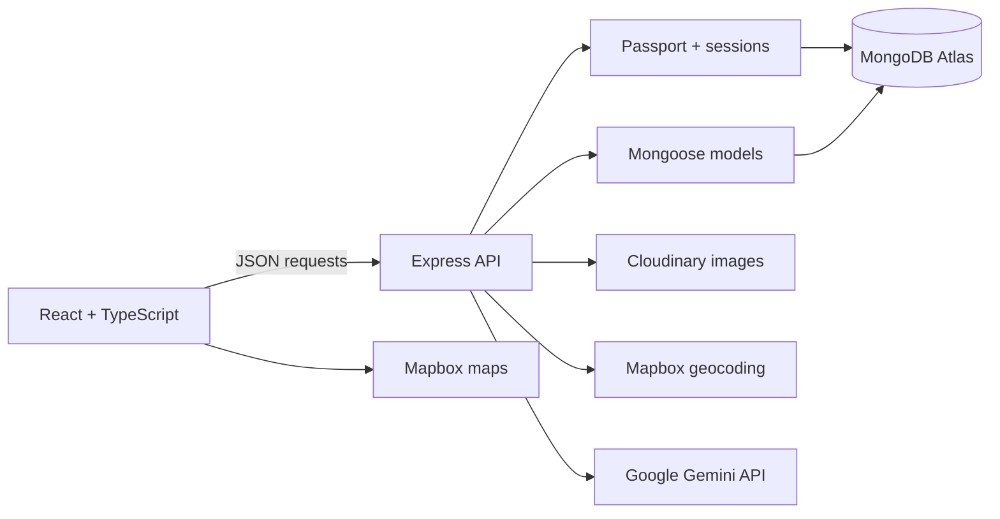
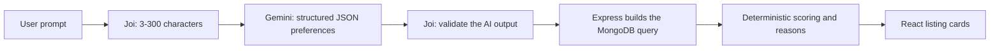

# StaySphere

**A full-stack accommodation marketplace for discovering, sharing, and reviewing unique stays.**

[Live application](https://staysphere-f4xw.onrender.com) · [GitHub repository](https://github.com/mantramehta/StaySphere)

StaySphere is a React and Express application with search, category filters, interactive maps, image uploads, reviews, and ownership-based authorization. It began as an EJS project, was migrated to a typed React frontend backed by a JSON API, and now includes an **AI travel concierge** that turns natural-language requests into searches over real listings.

> The application runs on Render's free tier, so the first request after inactivity can take about a minute while the service wakes up.

## Preview

| Home | Explore stays |
|---|---|
|  |  |

## What users can do

- Describe a stay in plain English, such as "a mountain stay in India under $200", and get real matching listings with reasons.
- Search listings by title, location, or country.
- Combine search with 11 accommodation categories.
- View listing details and locations on an interactive Mapbox map.
- Register, log in, and keep an authenticated session across page reloads.
- Create listings with an image upload and automatically geocoded coordinates.
- Edit or delete only the listings they own.
- Post reviews and delete only their own reviews.
- Use the responsive interface on desktop and mobile screens.

## Engineering highlights

- **AI search without AI-generated queries:** Gemini only converts a request into a fixed, validated set of preferences. Express builds the MongoDB query and ranks results with deterministic rules, so recommendations always come from real listings.
- **React migration:** The original server-rendered UI was replaced with React, TypeScript, Vite, and React Router while the Express and Mongoose domain models were retained.
- **Server-side authorization:** Protected API operations verify the authenticated user on the server; hiding a button in React is never treated as authorization.
- **Persistent sessions:** Passport sessions are stored in MongoDB with `connect-mongo`, so authentication is not lost when the server restarts.
- **Safe image lifecycle:** Uploads use Multer memory storage and Cloudinary upload streams. Replaced and deleted listing images are also removed from Cloudinary.
- **Location pipeline:** Express sends a listing's location to Mapbox Geocoding, stores the returned GeoJSON point, and React uses that point to render the map.
- **Consistent API errors:** API failures use a predictable `{ error: { code, message } }` shape with appropriate HTTP status codes.
- **Production SPA hosting:** In production, Express serves the Vite build and falls back to `index.html` for React Router deep links.

## Architecture



The project uses one repository and one production service. During development, Vite runs the frontend on port `5173` and proxies `/api` requests to Express on port `8080`. In production, Express serves both the API and the compiled React application.

## AI travel concierge (V3)

Users can describe the stay they want in natural language. StaySphere interprets the request with an LLM, then searches and ranks **real listings from MongoDB**. It is a search feature, not a chatbot.

**Core principle: the AI understands the request; the backend controls the search.**



### How a request is processed

1. React sends `{ "prompt": "..." }` to `POST /api/ai/recommendations`.
2. Rate limits run first (5 requests per minute per visitor, plus app-wide limits kept below the Gemini free-tier quota), followed by Joi validation of the prompt.
3. `utils/aiService.js` calls Gemini with a system instruction and a **JSON response schema**, so the model must return this shape:

   ```json
   { "isTravelRequest": true, "destination": "India", "minPrice": null, "maxPrice": 200,
     "categories": ["mountains"], "keywords": ["peaceful"], "unsupported": [] }
   ```

4. The response is validated again with Joi. Categories must be real listing categories (read from the Mongoose enum), prices must be non-negative numbers, destinations and keywords may only contain letters, and unknown fields are removed. Invalid output is rejected instead of being used.
5. `utils/recommendationService.js` treats preferences in two ways:
   - **Hard constraints** (budget and destination) go into the MongoDB query, so results never break them.
   - **Soft preferences** (category and keywords) only affect ranking: category match +3, keyword in title +2, keyword in description +1. Ties go to the cheaper stay, and the top 12 are returned.
6. Each result includes reasons built only from stored fields, for example *"Matches your mountains preference"* or *"$135/night, within your $200 budget"*.

### Design decisions

- **No AI-generated database queries.** The model fills in a fixed form, and Express decides how to search. Even a successful prompt injection can only change filter values.
- **Validate twice.** The response schema makes Gemini produce the right shape; Joi verifies it on the server, because a provider's guarantees are not a substitute for our own validation.
- **Honest explanations.** The listing schema has no amenities or atmosphere fields, so words like "peaceful" are matched against listing text and explained as *"Description mentions 'peaceful'"*. Requests StaySphere cannot filter by, such as guest counts or dates, are reported back to the user.
- **Graceful failure.** Gemini calls time out after 8 seconds. Timeouts, quota errors, invalid AI output, and off-topic prompts return friendly messages, and the regular search keeps working without AI.
- **Simple by design.** There is no RAG, no vector database, no LangChain, and no Gemini SDK; it is one `fetch` call to one REST endpoint.

### API

`POST /api/ai/recommendations`

```json
{ "prompt": "Find a mountain stay under $200 per night in India" }
```

```json
{
  "data": [
    {
      "listing": { "_id": "...", "title": "Himalayan Retreat in Manali", "price": 135, "location": "Manali", "country": "India", "category": "mountains" },
      "score": 3,
      "reasons": ["Located in Manali, India", "Matches your mountains preference", "$135/night, within your $200 budget"]
    }
  ],
  "meta": {
    "count": 1,
    "preferences": { "destination": "India", "minPrice": null, "maxPrice": 200, "categories": ["mountains"], "keywords": [] },
    "unsupported": []
  }
}
```

| Status | Code | When |
|---|---|---|
| 400 | `VALIDATION_ERROR` | Missing, empty, or longer than 300 characters |
| 422 | `NOT_A_TRAVEL_REQUEST` | Off-topic request, such as "write me a poem" |
| 429 | `RATE_LIMITED` | Too many AI searches in a short period |
| 502 | `AI_INVALID_RESPONSE` | The model's output failed validation |
| 503 | `AI_UNAVAILABLE` | Timeout, quota exhausted, or provider error |

### Testing and evaluation

- **Unit tests (`npm test`):** 26 tests using Node's built-in test runner. They cover prompt validation, AI-output validation (non-JSON text, invented categories, negative prices, injected query operators), provider failures and timeouts simulated with a mocked `fetch`, and the filter, scoring, and ranking logic.
- **Live evaluation (`npm run eval:ai`):** 15 representative prompts run against the real Gemini API and database. The script checks the extracted preferences against expected values, confirms every returned listing ID exists in MongoDB, and checks every result against the budget and destination limits.

Results from one evaluation run on October 27, 2026 (`gemini-3.5-flash-lite`, 56 listings). LLM output can vary between runs.

| Measure | Result |
|---|---|
| Preferences matched expectations (budget, location, category, combined, no constraints, impossible, unsupported, prompt injection) | 13 / 13 |
| Off-topic and instruction-extraction prompts rejected | 2 / 2 |
| Returned listing IDs found in MongoDB | 71 / 71 |
| Results breaking a budget or destination limit | 0 |
| Gemini response time | median 971 ms, slowest 1347 ms |

### Known limitations

- Keyword matching is plain text matching. Synonyms help recall but can also lower precision; for example, "houseboat" also returned lakeside stays because the model added "water" and "lake".
- Listings do not store amenities, guest capacity, or availability, so those requests cannot be filtered.
- Rate-limit counters are kept in memory, which fits a single server instance; multiple instances would need a shared store such as Redis.
- On the Gemini free tier, prompts may be used by Google to improve its products, as noted on the Privacy page.

## API overview

All application data is exchanged as JSON, except listing create/edit requests, which use `multipart/form-data` for image uploads.

| Method | Endpoint | Purpose | Access |
|---|---|---|---|
| `GET` | `/api/auth/me` | Read the current session | Public |
| `POST` | `/api/auth/register` | Create an account and session | Public |
| `POST` | `/api/auth/login` | Start a session | Public |
| `POST` | `/api/auth/logout` | End the current session | Signed in |
| `GET` | `/api/listings` | List, search, and filter stays | Public |
| `GET` | `/api/listings/:id` | Read one stay and its reviews | Public |
| `POST` | `/api/listings` | Create a stay | Signed in |
| `PATCH` | `/api/listings/:id` | Edit a stay | Listing owner |
| `DELETE` | `/api/listings/:id` | Delete a stay | Listing owner |
| `POST` | `/api/listings/:id/reviews` | Add a review | Signed in |
| `DELETE` | `/api/listings/:id/reviews/:reviewId` | Delete a review | Review author |
| `POST` | `/api/ai/recommendations` | Natural-language stay recommendations | Public, rate limited |

`GET /api/listings` accepts optional `search` and `category` query parameters. When both are present, the API searches only within the selected category.

## Tech stack

| Area | Technology |
|---|---|
| Frontend | React 19, TypeScript, Vite, React Router, CSS |
| Backend | Node.js, Express 5 |
| Data | MongoDB Atlas, Mongoose |
| Authentication | Passport.js, `express-session`, `connect-mongo` |
| Validation | Joi |
| Images | Multer, Cloudinary |
| Maps | Mapbox GL JS, Mapbox Geocoding API |
| AI | Google Gemini API (structured JSON output), `express-rate-limit` |
| Testing | Node.js built-in test runner |
| Hosting | Render |

## Project structure

```text
StaySphere/
├── client/
│   ├── public/                 # Logo and browser assets
│   └── src/
│       ├── components/         # Cards, AI search, footer, and map
│       ├── pages/              # Route-level React pages
│       ├── App.tsx             # Layout, auth state, and routes
│       ├── types.ts            # Shared frontend API types
│       └── App.css             # Responsive application styles
├── controllers/api/            # API request handlers
├── routes/api/                 # Express route definitions
├── models/                     # Mongoose models
├── utils/                      # Errors, filters, AI service, ranking
├── tests/                      # Unit tests (node --test)
├── scripts/                    # Live AI evaluation script
├── init/                       # Guarded development seed data
├── app.js                      # Express setup and server startup
├── middleware.js               # Validation and authorization
├── schema.js                   # Joi request schemas
└── cloudConfig.js              # Cloudinary upload integration
```

## Run locally

### Prerequisites

- Node.js 24 and npm
- An isolated MongoDB database
- A Cloudinary account
- A Mapbox public access token
- A Gemini API key from [Google AI Studio](https://aistudio.google.com/apikey)

### 1. Clone and install

```bash
git clone https://github.com/mantramehta/StaySphere.git
cd StaySphere
npm install
npm install --prefix client
```

### 2. Configure the backend

Copy `.env.example` to `.env` and replace the placeholders:

| Variable | Used for |
|---|---|
| `ATLASDB_URL` | MongoDB connection string |
| `SECRET` | Session signing and session-store encryption |
| `MAP_TOKEN` | Server-side Mapbox geocoding |
| `CLOUD_NAME` | Cloudinary account name |
| `CLOUD_API_KEY` | Cloudinary API key |
| `CLOUD_API_SECRET` | Cloudinary API secret |
| `CLOUDINARY_FOLDER` | Folder for uploaded development images |
| `DEV_SEED_PASSWORD` | Development-only seed account password |
| `GEMINI_API_KEY` | Server-side Gemini API key for AI search |
| `GEMINI_MODEL` | Gemini model name; defaults to `gemini-3.5-flash-lite` |
| `PORT` | Local Express port; defaults to `8080` |

Copy `client/.env.example` to `client/.env.local` and provide:

```env
VITE_MAP_TOKEN=your_url_restricted_public_mapbox_token
```

Never commit either real environment file. Use a separate development database and separate development credentials.

### 3. Start both development servers

Terminal 1:

```bash
npm start
```

Terminal 2:

```bash
npm run dev --prefix client
```

Open `http://localhost:5173`.

### Optional development data

```bash
npm run seed:dev
```

The seed script refuses to run unless the connected database is named `staysphere_dev`. It must never be used with the production database.

## Build and quality checks

```bash
npm test          # unit tests, no network or API key needed
npm run eval:ai   # live AI evaluation; uses about 15 Gemini requests
npm run build
npm run lint
npm audit --omit=dev
```

Unit tests cover the AI feature's validation, failure handling, and ranking. The rest of the application relies on build, lint, dependency-audit, and manual end-to-end checks.

## Deployment

The Render Web Service builds the React client and then starts Express:

```text
Build: npm install && npm run build
Start: npm start
```

Render supplies production environment variables, including `NODE_ENV=production`. The server connects to MongoDB before it begins listening, serves `client/dist`, and uses secure session cookies behind Render's proxy.

## Security and reliability choices

- Passwords are salted and hashed by `passport-local-mongoose`; raw passwords are not stored.
- Joi validates incoming authentication, listing, and review data.
- Listing ownership and review authorship are checked by Express middleware.
- Uploaded files are limited to images and capped at 5 MB.
- Session cookies are HTTP-only, `SameSite=Lax`, and secure in production.
- Database, Cloudinary, session, and Mapbox secrets stay in environment variables.
- The development seed script is guarded against production use.
- The Gemini API key is used only by Express and is never sent to the browser.
- AI output is validated before use, and AI-provided text is escaped before it is used in a database regex.
- AI search is rate limited per visitor and app-wide to protect the shared API quota.

## Roadmap

- Extend automated tests to authentication, listings, reviews, and React components.
- Add pagination to the listing endpoint.
- Improve keyboard and screen-reader testing.
- Add saved stays and user profile pages.

## Author

**Mantra Mehta** — M.S. Computer Science

[LinkedIn](https://www.linkedin.com/in/mantra-mehta/) · [GitHub](https://github.com/mantramehta)
