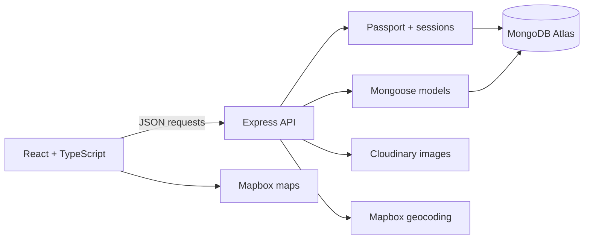

# StaySphere

**A full-stack accommodation marketplace for discovering, sharing, and reviewing unique stays.**

[Live application](https://staysphere-f4xw.onrender.com) · [GitHub repository](https://github.com/mantramehta/StaySphere)

StaySphere is a React and Express application with search, category filters, interactive maps, image uploads, reviews, and ownership-based authorization. It began as an EJS project and was migrated to a typed React frontend backed by a JSON API.

> The application runs on Render's free tier, so the first request after inactivity can take about a minute while the service wakes up.

## Preview

| Home | Explore stays |
|---|---|
|  |  |

## What users can do

- Search listings by title, location, or country.
- Combine search with 11 accommodation categories.
- View listing details and locations on an interactive Mapbox map.
- Register, log in, and keep an authenticated session across page reloads.
- Create listings with an image upload and automatically geocoded coordinates.
- Edit or delete only the listings they own.
- Post reviews and delete only their own reviews.
- Use the responsive interface on desktop and mobile screens.

## Engineering highlights

- **React migration:** The original server-rendered UI was replaced with React, TypeScript, Vite, and React Router while the Express and Mongoose domain models were retained.
- **Server-side authorization:** Protected API operations verify the authenticated user on the server; hiding a button in React is never treated as authorization.
- **Persistent sessions:** Passport sessions are stored in MongoDB with `connect-mongo`, so authentication is not lost when the server restarts.
- **Safe image lifecycle:** Uploads use Multer memory storage and Cloudinary upload streams. Replaced and deleted listing images are also removed from Cloudinary.
- **Location pipeline:** Express sends a listing's location to Mapbox Geocoding, stores the returned GeoJSON point, and React uses that point to render the map.
- **Consistent API errors:** API failures use a predictable `{ error: { code, message } }` shape with appropriate HTTP status codes.
- **Production SPA hosting:** In production, Express serves the Vite build and falls back to `index.html` for React Router deep links.

## Architecture



The project uses one repository and one production service. During development, Vite runs the frontend on port `5173` and proxies `/api` requests to Express on port `8080`. In production, Express serves both the API and the compiled React application.

## API overview

All application data is exchanged as JSON, except listing create/edit requests, which use `multipart/form-data` for image uploads.

| Method | Endpoint | Purpose | Access |
|---|---|---|---|
| `GET` | `/api/auth/me` | Read the current session | Public |
| `POST` | `/api/auth/register` | Create an account and session | Public |
| `POST` | `/api/auth/login` | Start a session | Public |
| `POST` | `/api/auth/logout` | End the current session | Signed in |
| `GET` | `/api/listings` | List, search, and filter stays | Public |
| `GET` | `/api/listings/:id` | Read one stay and its reviews | Public |
| `POST` | `/api/listings` | Create a stay | Signed in |
| `PATCH` | `/api/listings/:id` | Edit a stay | Listing owner |
| `DELETE` | `/api/listings/:id` | Delete a stay | Listing owner |
| `POST` | `/api/listings/:id/reviews` | Add a review | Signed in |
| `DELETE` | `/api/listings/:id/reviews/:reviewId` | Delete a review | Review author |

`GET /api/listings` accepts optional `search` and `category` query parameters. When both are present, the API searches only within the selected category.

## Tech stack

| Area | Technology |
|---|---|
| Frontend | React 19, TypeScript, Vite, React Router, CSS |
| Backend | Node.js, Express 5 |
| Data | MongoDB Atlas, Mongoose |
| Authentication | Passport.js, `express-session`, `connect-mongo` |
| Validation | Joi |
| Images | Multer, Cloudinary |
| Maps | Mapbox GL JS, Mapbox Geocoding API |
| Hosting | Render |

## Project structure

```text
StaySphere/
├── client/
│   ├── public/                 # Logo and browser assets
│   └── src/
│       ├── components/         # Shared cards, footer, and map
│       ├── pages/              # Route-level React pages
│       ├── App.tsx             # Layout, auth state, and routes
│       ├── types.ts            # Shared frontend API types
│       └── App.css             # Responsive application styles
├── controllers/api/            # API request handlers
├── routes/api/                 # Express route definitions
├── models/                     # Mongoose models
├── utils/                      # Errors, async wrapper, filters
├── init/                       # Guarded development seed data
├── app.js                      # Express setup and server startup
├── middleware.js               # Validation and authorization
├── schema.js                   # Joi request schemas
└── cloudConfig.js              # Cloudinary upload integration
```

## Run locally

### Prerequisites

- Node.js 24 and npm
- An isolated MongoDB database
- A Cloudinary account
- A Mapbox public access token

### 1. Clone and install

```bash
git clone https://github.com/mantramehta/StaySphere.git
cd StaySphere
npm install
npm install --prefix client
```

### 2. Configure the backend

Copy `.env.example` to `.env` and replace the placeholders:

| Variable | Used for |
|---|---|
| `ATLASDB_URL` | MongoDB connection string |
| `SECRET` | Session signing and session-store encryption |
| `MAP_TOKEN` | Server-side Mapbox geocoding |
| `CLOUD_NAME` | Cloudinary account name |
| `CLOUD_API_KEY` | Cloudinary API key |
| `CLOUD_API_SECRET` | Cloudinary API secret |
| `CLOUDINARY_FOLDER` | Folder for uploaded development images |
| `DEV_SEED_PASSWORD` | Development-only seed account password |
| `PORT` | Local Express port; defaults to `8080` |

Copy `client/.env.example` to `client/.env.local` and provide:

```env
VITE_MAP_TOKEN=your_url_restricted_public_mapbox_token
```

Never commit either real environment file. Use a separate development database and separate development credentials.

### 3. Start both development servers

Terminal 1:

```bash
npm start
```

Terminal 2:

```bash
npm run dev --prefix client
```

Open `http://localhost:5173`.

### Optional development data

```bash
npm run seed:dev
```

The seed script refuses to run unless the connected database is named `staysphere_dev`. It must never be used with the production database.

## Build and quality checks

```bash
npm run build
npm run lint
npm audit --omit=dev
```

The repository currently relies on build, lint, dependency-audit, and manual end-to-end checks. Automated API and component tests are a planned improvement.

## Deployment

The Render Web Service builds the React client and then starts Express:

```text
Build: npm install && npm run build
Start: npm start
```

Render supplies production environment variables, including `NODE_ENV=production`. The server connects to MongoDB before it begins listening, serves `client/dist`, and uses secure session cookies behind Render's proxy.

## Security and reliability choices

- Passwords are salted and hashed by `passport-local-mongoose`; raw passwords are not stored.
- Joi validates incoming authentication, listing, and review data.
- Listing ownership and review authorship are checked by Express middleware.
- Uploaded files are limited to images and capped at 5 MB.
- Session cookies are HTTP-only, `SameSite=Lax`, and secure in production.
- Database, Cloudinary, session, and Mapbox secrets stay in environment variables.
- The development seed script is guarded against production use.

## Roadmap

- Add automated API, authentication, and React component tests.
- Add pagination to the listing endpoint.
- Improve keyboard and screen-reader testing.
- Add saved stays and user profile pages.

## Author

**Mantra Mehta** — M.S. Computer Science

[LinkedIn](https://www.linkedin.com/in/mantra-mehta/) · [GitHub](https://github.com/mantramehta)
