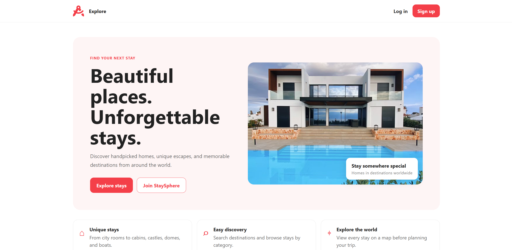
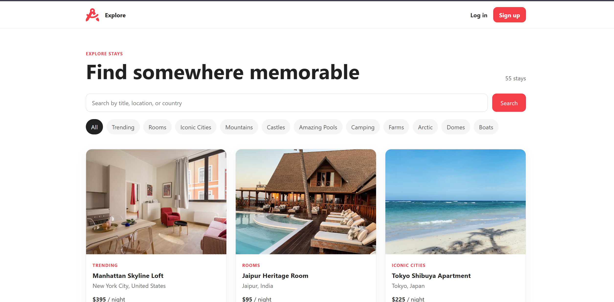
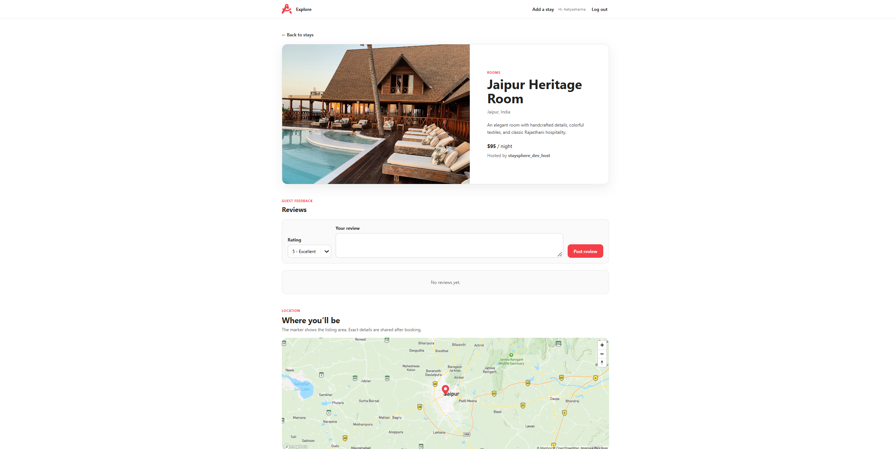
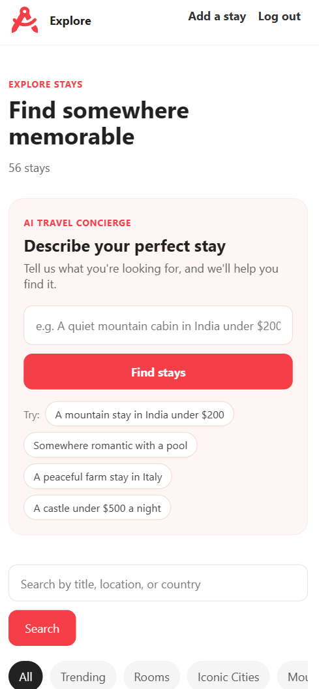
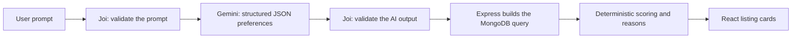
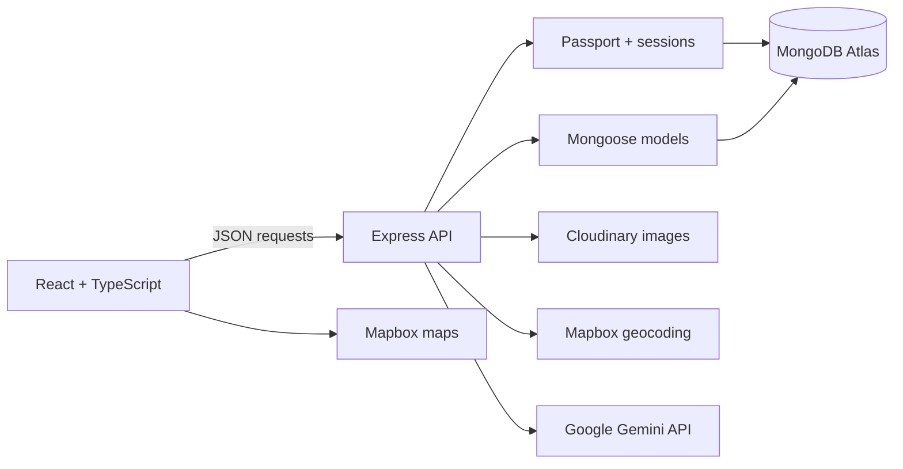

<div align="center">

# StaySphere

**A full-stack accommodation marketplace with an AI travel concierge.**
Describe your ideal stay in plain English, and StaySphere finds real matching listings and explains why each one fits.

[**Live demo**](https://staysphere-f4xw.onrender.com) · [Features](#features) · [AI concierge](#ai-travel-concierge) · [Architecture](#architecture) · [Run locally](#run-locally)


</div>

> The live demo runs on Render's free tier, so the first request after inactivity can take about a minute while the server wakes up.

## Highlights

- **AI search that can't go rogue.** Gemini only turns a request into a fixed, validated set of preferences. Express builds the database query and ranks results with deterministic rules, so every recommendation is a real listing.
- **Measured, not guessed.** 26 unit tests, plus a live evaluation of 15 prompts against the real model and database: 15/15 cases passed, 71/71 returned listings verified in MongoDB, and 0 results broke a budget or destination limit.
- **End-to-end product.** Authentication, authorization, image uploads, geocoding, maps, reviews, and a live production deployment in one app.
- **Real migration experience.** Started as a server-rendered EJS app, migrated to a typed React frontend with a JSON API, then extended with AI, all without rewriting the backend domain models.

## Features

| | |
|---|---|
| **AI travel concierge** | Type "a mountain stay in India under $200" and get ranked, real listings with reasons such as "$135/night, within your $200 budget". |
| **Search and filters** | Search by title, location, or country and combine it with 11 accommodation categories. |
| **Interactive maps** | Every listing is geocoded automatically and shown on a Mapbox map. |
| **Accounts** | Sign up, log in, and stay signed in across reloads and server restarts. |
| **Host your own stay** | Create listings with image uploads; edit or delete only your own. |
| **Reviews** | Rate and review stays; delete only your own reviews. |
| **Responsive** | Designed for desktop and mobile. |

## Screenshots

| Home | Explore stays |
|---|---|
|  |  |
| **Listing details with map and reviews** | **AI search on mobile** |
|  |  |

## AI travel concierge

**Core principle: the AI understands the request; the backend controls the search.**



1. **Understand.** Gemini receives the prompt with a JSON response schema and must return a fixed shape: destination, budget, categories, keywords, and anything StaySphere can't filter by.
2. **Verify.** Joi validates the AI output on the server. Categories must exist in the Mongoose enum, prices must be valid numbers, and unknown fields are stripped. Invalid output is rejected, never used.
3. **Search.** Budget and destination are **hard constraints** in the MongoDB query, so results never break them.
4. **Rank and explain.** Category and keywords are **soft preferences** that only affect ranking (category +3, keyword in title +2, keyword in description +1). Every result includes reasons built only from stored listing data.

### Design decisions

- **No AI-generated database queries.** The model fills in a form; Express decides how to search. Even a successful prompt injection can only change filter values.
- **Validate twice.** The response schema shapes the output; Joi verifies it, because a provider's guarantees don't replace server-side validation.
- **Honest explanations.** Requests StaySphere can't filter by, such as dates or guest counts, are shown back to the user instead of being silently ignored.
- **Graceful failure.** An 8-second timeout, friendly errors for quota limits, invalid output, and off-topic prompts, and the regular search keeps working without AI.
- **Cost protection.** Rate limits per visitor (5/minute) and app-wide limits keep usage below the Gemini free-tier quota.
- **Simple by design.** No RAG, vector database, LangChain, or SDK: one `fetch` call to one REST endpoint.

### Evaluation

Results from one live run on October 27, 2026 (`gemini-3.5-flash-lite`, 56 listings). LLM output can vary between runs.

| Measure | Result |
|---|---|
| Preferences matched expectations (budget, location, category, combined, no constraints, impossible, unsupported, prompt injection) | 13 / 13 |
| Off-topic and instruction-extraction prompts rejected | 2 / 2 |
| Returned listing IDs found in MongoDB | 71 / 71 |
| Results breaking a budget or destination limit | 0 |
| Gemini response time | median 971 ms, slowest 1347 ms |

<details>
<summary><strong>API request, response, and errors</strong></summary>

`POST /api/ai/recommendations`

```json
{ "prompt": "Find a mountain stay under $200 per night in India" }
```

```json
{
  "data": [
    {
      "listing": { "_id": "...", "title": "Himalayan Retreat in Manali", "price": 135, "location": "Manali", "country": "India", "category": "mountains" },
      "score": 3,
      "reasons": ["Located in Manali, India", "Matches your mountains preference", "$135/night, within your $200 budget"]
    }
  ],
  "meta": {
    "count": 1,
    "preferences": { "destination": "India", "minPrice": null, "maxPrice": 200, "categories": ["mountains"], "keywords": [] },
    "unsupported": []
  }
}
```

| Status | Code | When |
|---|---|---|
| 400 | `VALIDATION_ERROR` | Missing, empty, or longer than 300 characters |
| 422 | `NOT_A_TRAVEL_REQUEST` | Off-topic request, such as "write me a poem" |
| 429 | `RATE_LIMITED` | Too many AI searches in a short period |
| 502 | `AI_INVALID_RESPONSE` | The model's output failed validation |
| 503 | `AI_UNAVAILABLE` | Timeout, quota exhausted, or provider error |

</details>

<details>
<summary><strong>Known limitations</strong></summary>

- Keyword matching is plain text matching. Synonyms help recall but can lower precision; for example, "houseboat" also returned lakeside stays because the model added "water" and "lake".
- Listings don't store amenities, guest capacity, or availability, so those requests can't be filtered.
- Rate-limit counters live in memory, which fits a single server; multiple instances would need a shared store such as Redis.
- On the Gemini free tier, Google may use prompts to improve its products, as noted on the Privacy page.

</details>

## Architecture



One repository, one production service. In development, Vite serves React on port `5173` and proxies `/api` to Express on `8080`. In production, Express serves both the API and the compiled React app, with a fallback to `index.html` for React Router deep links.

### Engineering decisions

- **Server-side authorization:** Ownership is checked in Express middleware. Hiding a button in React is never treated as security.
- **Persistent sessions:** Passport sessions are stored in MongoDB with `connect-mongo`, so users stay signed in when the server restarts.
- **Safe image lifecycle:** Multer memory storage streams uploads to Cloudinary, and replaced or deleted images are removed from Cloudinary too.
- **Location pipeline:** Express geocodes each listing with Mapbox and stores a GeoJSON point that React renders on the map.
- **Consistent API errors:** Every failure uses the same `{ error: { code, message } }` shape with the right HTTP status.

### Project evolution

| Version | What changed |
|---|---|
| V1 | Server-rendered Express and EJS marketplace with authentication, reviews, uploads, and maps |
| V2 | Migrated the UI to React, TypeScript, Vite, and React Router on top of a JSON API |
| V3 | Added the AI travel concierge with validated structured output, deterministic ranking, tests, and live evaluation |

## Tech stack

| Area | Technology |
|---|---|
| Frontend | React 19, TypeScript, Vite, React Router, CSS |
| Backend | Node.js, Express 5 |
| Data | MongoDB Atlas, Mongoose |
| AI | Google Gemini API (structured JSON output), `express-rate-limit` |
| Authentication | Passport.js, `express-session`, `connect-mongo` |
| Validation | Joi |
| Images and maps | Multer, Cloudinary, Mapbox GL JS, Mapbox Geocoding |
| Testing | Node.js built-in test runner |
| Hosting | Render |

<details>
<summary><strong>REST API overview</strong></summary>

All data is exchanged as JSON, except listing create/edit requests, which use `multipart/form-data` for image uploads.

| Method | Endpoint | Purpose | Access |
|---|---|---|---|
| `GET` | `/api/auth/me` | Read the current session | Public |
| `POST` | `/api/auth/register` | Create an account and session | Public |
| `POST` | `/api/auth/login` | Start a session | Public |
| `POST` | `/api/auth/logout` | End the current session | Signed in |
| `GET` | `/api/listings` | List, search, and filter stays | Public |
| `GET` | `/api/listings/:id` | Read one stay and its reviews | Public |
| `POST` | `/api/listings` | Create a stay | Signed in |
| `PATCH` | `/api/listings/:id` | Edit a stay | Listing owner |
| `DELETE` | `/api/listings/:id` | Delete a stay | Listing owner |
| `POST` | `/api/listings/:id/reviews` | Add a review | Signed in |
| `DELETE` | `/api/listings/:id/reviews/:reviewId` | Delete a review | Review author |
| `POST` | `/api/ai/recommendations` | Natural-language stay recommendations | Public, rate limited |

`GET /api/listings` accepts optional `search` and `category` query parameters. When both are present, the API searches only within the selected category.

</details>

<details>
<summary><strong>Project structure</strong></summary>

```text
StaySphere/
├── client/
│   ├── public/                 # Logo and browser assets
│   └── src/
│       ├── components/         # Cards, AI search, footer, and map
│       ├── pages/              # Route-level React pages
│       ├── App.tsx             # Layout, auth state, and routes
│       ├── types.ts            # Shared frontend API types
│       └── App.css             # Responsive application styles
├── controllers/api/            # API request handlers
├── routes/api/                 # Express route definitions
├── models/                     # Mongoose models
├── utils/                      # Errors, filters, AI service, ranking
├── tests/                      # Unit tests (node --test)
├── scripts/                    # Live AI evaluation script
├── init/                       # Guarded development seed data
├── app.js                      # Express setup and server startup
├── middleware.js               # Validation and authorization
├── schema.js                   # Joi request schemas
└── cloudConfig.js              # Cloudinary upload integration
```

</details>

## Run locally

**Prerequisites:** Node.js 24, a separate development MongoDB database, a Cloudinary account, a Mapbox public token, and a Gemini API key from [Google AI Studio](https://aistudio.google.com/apikey).

```bash
git clone https://github.com/mantramehta/StaySphere.git
cd StaySphere
npm install
npm install --prefix client
```

Copy `.env.example` to `.env`, and `client/.env.example` to `client/.env.local`, then fill in the placeholders. Never commit real environment files.

<details>
<summary><strong>Environment variables</strong></summary>

| Variable | Used for |
|---|---|
| `ATLASDB_URL` | MongoDB connection string |
| `SECRET` | Session signing and session-store encryption |
| `MAP_TOKEN` | Server-side Mapbox geocoding |
| `CLOUD_NAME` | Cloudinary account name |
| `CLOUD_API_KEY` | Cloudinary API key |
| `CLOUD_API_SECRET` | Cloudinary API secret |
| `CLOUDINARY_FOLDER` | Folder for uploaded development images |
| `DEV_SEED_PASSWORD` | Development-only seed account password |
| `GEMINI_API_KEY` | Server-side Gemini API key for AI search |
| `GEMINI_MODEL` | Gemini model name; defaults to `gemini-3.5-flash-lite` |
| `PORT` | Local Express port; defaults to `8080` |
| `VITE_MAP_TOKEN` | Public, URL-restricted Mapbox token (in `client/.env.local`) |

</details>

Start both servers, then open `http://localhost:5173`:

```bash
npm start                    # Terminal 1: Express API on port 8080
npm run dev --prefix client  # Terminal 2: React app on port 5173
```

Optional sample data: `npm run seed:dev`. The script refuses to run unless the database is named `staysphere_dev`, so it can't touch production.

## Testing and quality checks

```bash
npm test          # 26 unit tests; no network or API key needed
npm run eval:ai   # live AI evaluation; uses about 15 Gemini requests
npm run build
npm run lint
npm audit --omit=dev
```

The unit tests use Node's built-in test runner and a mocked `fetch`. They cover prompt validation, AI-output validation (non-JSON text, invented categories, negative prices, injected query operators), provider failures and timeouts, and the filter, scoring, and ranking logic. The rest of the app is verified with build, lint, dependency-audit, and manual end-to-end checks.

## Deployment

Render builds the React client and starts Express (`npm install && npm run build`, then `npm start`). The server connects to MongoDB before it starts listening, serves `client/dist`, and uses secure session cookies behind Render's proxy.

## Security

- Passwords are salted and hashed by `passport-local-mongoose`; raw passwords are never stored.
- Joi validates all incoming authentication, listing, review, and AI data.
- Listing ownership and review authorship are enforced by Express middleware.
- Uploads are limited to images up to 5 MB.
- Session cookies are HTTP-only, `SameSite=Lax`, and secure in production.
- All secrets, including the Gemini API key, stay in server environment variables and never reach the browser.
- AI-provided text is escaped before it's used in a database regex.
- The development seed script is guarded against production use.

## Roadmap

- Extend automated tests to authentication, listings, reviews, and React components.
- Add pagination to the listing endpoint.
- Improve keyboard and screen-reader testing.
- Add saved stays and user profile pages.

## Author

**Mantra Mehta**, M.S. Computer Science

[LinkedIn](https://www.linkedin.com/in/mantra-mehta/) · [GitHub](https://github.com/mantramehta) · [Live demo](https://staysphere-f4xw.onrender.com)
